# Foundation state machines

Status: native design contract for `b4-contract` and the pure `b4-kernel`.
The shared runtime and memory/SQLite stores commit these transitions; a bounded
authenticated scripted HTTP adapter projects them. Grant validation and full
process recovery qualification remain open. The kernel accepts explicit facts
and returns a proposed commit plan; it performs no I/O and does not establish
durability by itself.

## Identity and transition inputs

A thread is a long-lived container. An execution is logical work across turns.
A turn is one active segment; approval parking finishes that segment. A task
belongs to one fixed batch. An effect identity remains stable across attempts.
The caller supplies identities, timestamp values, the current owner generation,
attempt results, definition availability and recovery facts. Revision values
protect proposed commits from stale writes.

Snapshots retain required `turn_history` and `attempt_history` ledgers. A new
turn or attempt identity must not reuse any earlier identity in that execution;
the current turn is the final turn-history entry and every recorded attempt is
present in attempt history. `attempts_used` equals the issued-attempt count.
Resume and recovery preserve and extend these ledgers. Version 1 is an unreleased
foundation draft; there is no legacy snapshot migration promise.

```mermaid
stateDiagram-v2
    [*] --> Accepted: admission proposal
    Accepted --> Running: start
    Running --> WaitingForApproval: all siblings settled or waiting
    WaitingForApproval --> Running: complete validated decision set and new turn
    Running --> Completed: final join succeeds
    Running --> Failed: deterministic reduction fails
    Running --> Running: known task failure; drain existing attempts
    Running --> Failed: known failure and no in-flight siblings
    Running --> CancelRequested: matching active turn and owner
    CancelRequested --> Cancelled: no effect remains in flight
    Running --> RecoveryBlocked: uncertain unsafe effect or unavailable revision
```

These are internal execution states. The scripted HTTP adapter exposes coarse
thread status `idle`, `busy`, and `interrupted`; admission uses the richer internal
state. It excludes approval execution and continuation. The proposed full-profile
wait approval-park quirk reports `idle` while execution still requires continuation;
that wire behavior remains unverified.

## Batches and tasks

Each execution definition contains sequential batches with a bounded parallel
task set. A batch captures one input-state snapshot. Task results are retained
independently, and the join applies patches in task-definition order, regardless
of result arrival order. Ordered append concatenates items in that order. Two
replacement writes to the same field fail deterministically. A failed join
must not publish a partially reduced state as successful completion.

```mermaid
stateDiagram-v2
    [*] --> Ready
    Ready --> WaitingForApproval: permission required before effect
    WaitingForApproval --> Ready: resolved once or always
    WaitingForApproval --> Denied: deny or cancelled decision
    Ready --> InFlight: caller dispatch proposal
    InFlight --> Succeeded: matching result
    InFlight --> Failed: matching explicitly settled failure
    InFlight --> Ready: qualified safe recovery with original effect ID
    InFlight --> OutcomeUnknown: unsafe or reconciliation required
    Ready --> Cancelled: execution cancellation
    InFlight --> Succeeded: effect settles during cancellation; retain result only
    InFlight --> Cancelled: qualified safe recovery of cancelled work
```

Approval must precede dispatch. A task waiting for a decision cannot park the
whole turn while a sibling remains in flight. Resume requires the recorded
parking route, a new turn identity, and exactly the pending interrupt set:
duplicates, omissions, extras and stale entries reject the whole proposal.
The kernel receives decisions already authorized by a future runtime; it does
not validate grants or persist permission scopes. A denial never dispatches the
denied tool. Completed siblings are not replayed by continuation.

Repeated delivery of an identical result is idempotent. Conflicting delivery
for the same completed attempt is an integrity error. Neither case may apply a
state patch a second time.

An explicitly known application failure records a Failed task, its matching
attempt and a nonempty reason bounded to 1,024 UTF-8 bytes, without a result.
The first committed reason becomes the execution failure. Ready and approval
waiting siblings become Cancelled; existing attempts drain under Running with a
failure reason. Dispatch and parking stop, and the admission slot stays occupied.
Late successes retain results without reducing the failed batch or creating later
batches. With no in-flight siblings, Failed releases the slot and has no output.
Identical failure redelivery is idempotent; changed reasons and success/failure
conflicts reject. A known failure takes precedence over cancellation.

## Cancellation and recovery

Cancellation addresses the captured execution, turn and owner generation.
A stale cancellation cannot retarget a newer turn. It prevents new dispatch
and retains committed results. The slot remains occupied while an effect is
still in flight; cancellation is not rollback or proof that external mutation
stopped.

A completion during cancellation records the task as succeeded and preserves
its result, while its late writes do not advance execution state. The execution
becomes cancelled only after all in-flight effects settle. Qualified safe recovery
of persisted cancellation can settle an unfinished task as cancelled; an unsafe
uncertain effect still requires reconciliation.

For recovery, supported snapshot version and exact definition revision are
preconditions. Completed results and pending interrupts are preserved. Pure or
declared externally idempotent work may retry with the original logical effect
identity and an explicit new attempt. Reconcilable and unsafe uncertain outcomes
block until a future runtime supplies a verified outcome. A declaration of
idempotence is an application contract, not a proof supplied by this kernel.

Recovery of a known failure drain cancels safe uncertain siblings without replay.
Unsafe/reconcilable uncertainty remains RecoveryBlocked. Per-task application
causes survive a changed execution-level recovery reason. Old version-1 snapshots
without task failure fields remain readable; new failure fields are omitted when
absent. Older binaries reject the added field/status. See
[settled-failure-design.md](settled-failure-design.md).

The execution attempt budget is immutable across approval continuation and
recovery. The caller cannot reset it by starting a new turn. The fixed program
bounds the number of batches/tasks; configurable step and global admission
budgets remain future runtime work.
Internal snapshot version 1 serializes this state; it is not an AP checkpoint.

## Verification boundary

Local tests in `crates/b4-kernel/tests/lifecycle.rs` exercise deterministic joins,
full-set continuation, duplicates, cancellation and safe recovery proposals.
They do not prove atomic store commits, actual concurrent admission, external
effect reconciliation, shutdown quiescence or process-kill recovery. Those
release scenarios remain pending in `requirements.yaml`.
